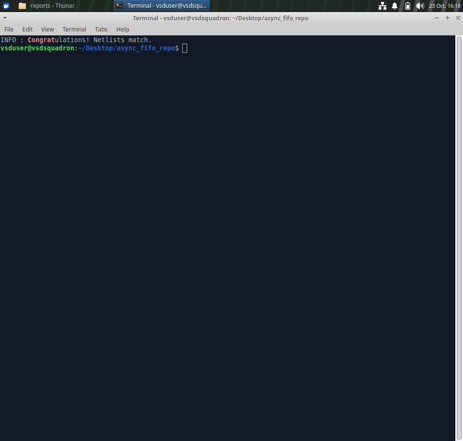
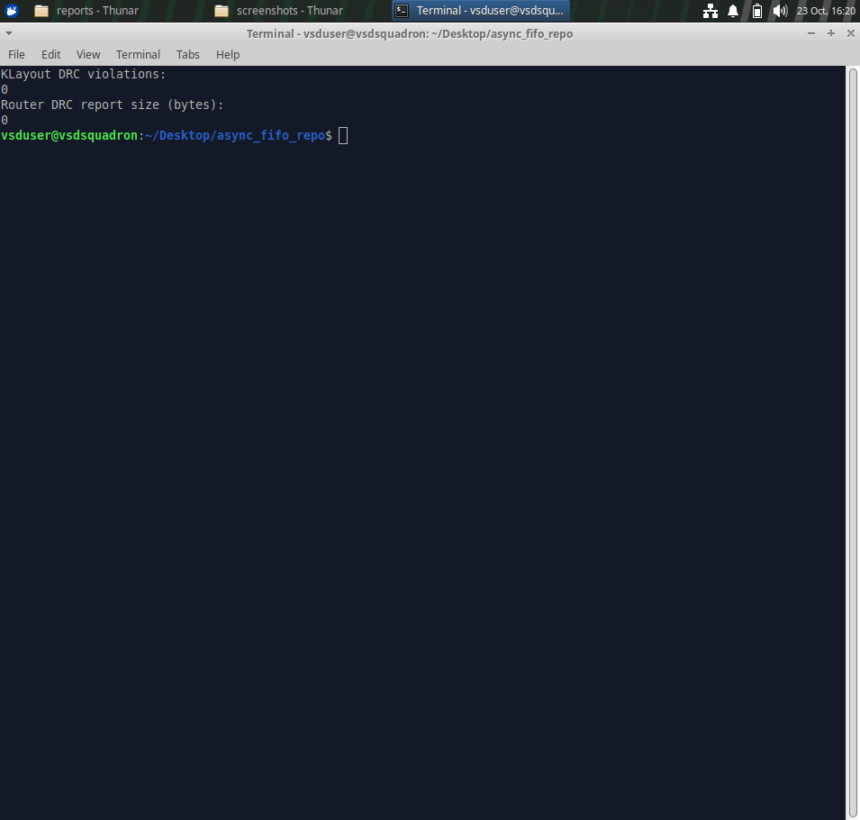
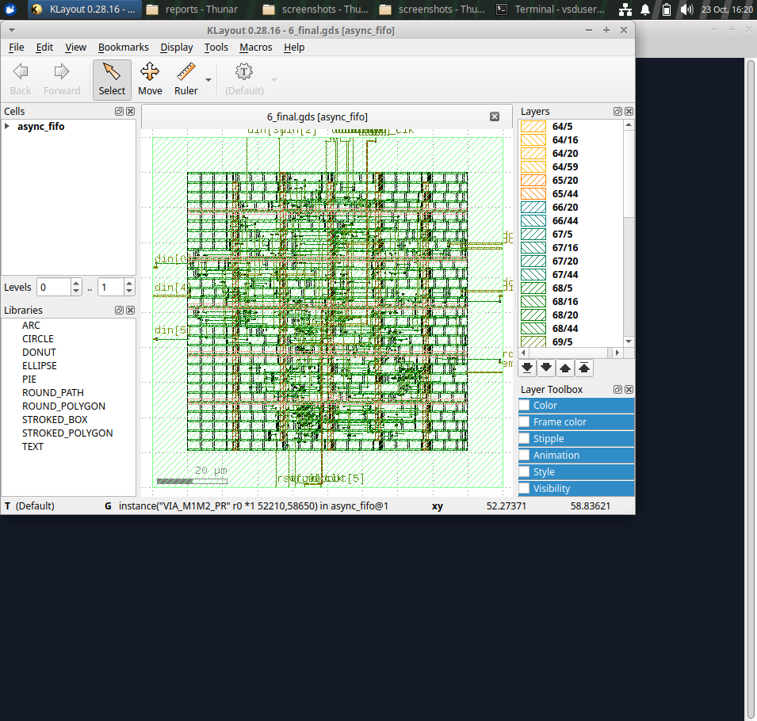

# Asynchronous FIFO: RTL to GDSII (SKY130HD)

An asynchronous FIFO written in Verilog, simulated with Icarus Verilog, and taken through physical design with OpenROAD-flow-scripts on the SKY130 HD platform.

## Repository contents

| Folder | Contents |
|---|---|
| `rtl/` | FIFO Verilog source |
| `testbench/` | RTL testbench |
| `simulation/` | Simulation log and waveform |
| `sta/` | Static timing reports (TT and FF corners, pre-route STA) |
| `reports/` | Synthesis, floorplan, placement, CTS, routing, DRC, LVS reports and flow images |
| `layout/` | Final GDSII and OpenDB |
| `screenshots/` | LVS, DRC and layout screenshots |

## Flow stages

| Stage | Tool | Status |
|---|---|---|
| RTL design and functional verification | Icarus Verilog, GTKWave | Done |
| Logic synthesis | Yosys | Done |
| Floorplan and power planning | OpenROAD | Done |
| Placement | OpenROAD | Done |
| Clock tree synthesis | OpenROAD | Done |
| Routing | OpenROAD | Done |
| Static timing analysis | OpenSTA | Done (TT and FF corners) |
| DRC | Router check, KLayout | Done, 0 violations |
| LVS | KLayout | Done, netlists match |
| GDSII generation | OpenROAD | Done (`layout/6_final.gds`) |
| DFT (scan insertion) | n/a | Not performed |

## Results

| Metric | Value |
|---|---|
| Technology | SKY130 HD |
| Synthesized chip area | 2335.99 um2 |
| TT (0.25 C, 1.80 V) setup / hold slack | +7.08 ns / +0.35 ns |
| FF (-40 C, 1.95 V) setup / hold slack | +7.80 ns / +0.22 ns |
| TNS | 0.00 |
| Router DRC violations | 0 |
| KLayout DRC violations | 0 |
| LVS | Netlists match |

Timing results apply only to the TT and FF corners listed. They do not show that every corner passes.

## Screenshots

### LVS

### DRC

### Final layout

## Simulation

    iverilog -o /tmp/async_fifo_sim rtl/async_fifo.v testbench/tb_async_fifo.v
    vvp /tmp/async_fifo_sim
    gtkwave simulation/async_fifo.vcd

## Scope

This repository publishes selected project deliverables and verified results, not the full OpenROAD installation.
## Project Video

A 6-minute walkthrough covering the async FIFO design, verification, the RTL-to-GDSII flow, and timing results:
https://drive.google.com/file/d/1z4F8CE7KB0DBJrFWUKbg4tWe44hDeFNH/view?usp=drivesdk

